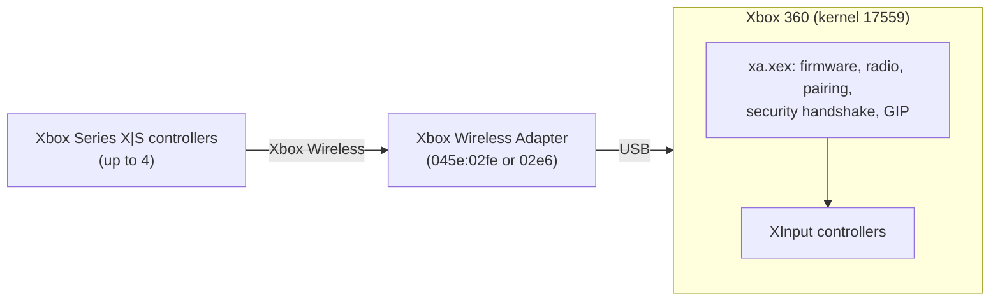

<div align="center">

# Xbox 360 Native Support for the Series Controller Receiver

**Up to 4 Xbox Series X|S controllers on an Xbox 360. Wireless, native, no extra hardware.**


[](https://buymeacoffee.com/jaccko)
[](LICENSE)


</div>

Plug Microsoft's **Xbox Wireless Adapter for Windows** into your Xbox 360, pair your Series
controllers, play. A small plugin that loads at boot drives the adapter directly from the 360
kernel, so the controllers show up as regular XInput controllers in the dashboard, Aurora and
games. No additional hardware.



## ✨ Features

- 🎮 **Up to four Series X|S controllers** at once, as standard XInput controllers.
- 📳 **Rumble**, all buttons, triggers and sticks, and the **Guide button** (opens the guide).
- 🔌 **Loads at boot** as a `launch.ini` plugin and picks up an adapter that's already plugged
  in. No replugging.
- 🔁 Paired controllers **reconnect by themselves** whenever they're switched on.
- 🔔 On-screen notifications when the driver starts and when the adapter is ready.
- 🤝 Leaves the console's own wireless receiver alone, so original 360 controllers keep working.

## 📋 Requirements

- An Xbox 360 on kernel **17559** that runs unsigned code and loads `launch.ini` plugins
  (for example [BadUpdate](https://github.com/grimdoomer/Xbox360BadUpdate) + XeUnshackle).
- Microsoft **Xbox Wireless Adapter for Windows**: the slim 2017 model (USB ID `045e:02fe`) or
  the original 2015 model (`045e:02e6`).
- The adapter's **firmware**, from Microsoft's Windows driver. It isn't redistributed here:
  [`get-firmware.ps1`](get-firmware.ps1) downloads it from Microsoft (see *Installation*). They're
  the same files the Linux [xone](https://github.com/dlundqvist/xone) driver installs as
  `/lib/firmware/xone_dongle_02fe.bin` and `xone_dongle_02e6.bin`.
- To build: [OpenXeChain](https://github.com/OpenXeChain) with the SynthXEX system-DLL patch
  (see *Building* below).

## 🚀 Installation

1. Download the zip from the [latest release](../../releases/latest) and extract it (or build
   `xa.xex` yourself, below).
2. Get the adapter firmware: double-click **`get-firmware.cmd`** in the extracted folder (it
   runs `get-firmware.ps1`; Windows doesn't run `.ps1` scripts directly by default). From a
   prompt, the same thing is:

   ```powershell
   powershell -ExecutionPolicy Bypass -File get-firmware.ps1
   ```

   It downloads Microsoft's driver packages from Windows Update, checks the firmware's SHA-256
   and saves `Apps\xadapter\xone_dongle_02fe.bin` (slim adapter) and `xone_dongle_02e6.bin`
   (original adapter); the plugin picks the one for the adapter you plug in. On Linux, copy
   xone's `/lib/firmware/xone_dongle_*.bin` into `Apps\xadapter\` instead.
3. Copy the `Apps` folder to the root of the console's USB stick or HDD, so it has:

   ```
   Usb:\Apps\xadapter\xa.xex
   Usb:\Apps\xadapter\xone_dongle_02fe.bin
   Usb:\Apps\xadapter\xone_dongle_02e6.bin
   ```

   (or the same under `Hdd:\`). The firmware just has to sit next to `xa.xex`; the plugin
   also checks `Apps\xadapter\` on the HDD and every USB drive.
4. Add the plugin to a free slot in `launch.ini`, with the path you copied it to:

   ```ini
   [Plugins]
   plugin4 = Usb:\Apps\xadapter\xa.xex
   ```

5. Plug in the adapter and restart the console.

When the plugin loads, the console shows *Wireless adapter: starting*; a few seconds after the
dashboard is up, *Wireless adapter: ready*.

## 🎮 Pairing and use

- The adapter accepts new controllers for **60 seconds** after it starts. Press the
  **pair button on the adapter** to open another 60-second window, then hold the pair button
  on the controller until its logo flashes quickly.
- A paired controller connects by itself when it's switched on; it doesn't need pairing mode.
- Each controller gets the next free player slot. The Guide button opens the guide, and games
  can use rumble as on a 360 controller.

## ⚠️ Limitations

- Kernel **17559** only: the plugin checks the kernel and XAM code it relies on at start-up, and
  does nothing on a mismatch.
- Controllers that use the older (v1, RSA) security handshake don't pair yet. Series X|S
  controllers use the newer (v2, ECDH) handshake and work.
- Headsets and chatpads aren't supported.

## ❓ FAQ

**How do I install this plugin?**

Extract the release zip, double-click `get-firmware.cmd` to fetch the adapter firmware, copy the `Apps`
folder to the console's USB stick or HDD, add `Usb:\Apps\xadapter\xa.xex` (or `Hdd:\...`) to a free `pluginN` line in
`launch.ini`, plug in the adapter and restart. The console needs kernel 17559 with BadUpdate + XeUnshackle (or anything
else that loads `launch.ini` plugins). Step by step: [Installation](#-installation).

**This is nothing new, is it?**

Not quite. Earlier plugins such as [hiddriver360](https://github.com/EinTim23/hiddriver360)
brought other controllers to the 360, but only over a USB cable: a Series controller had to
stay wired to the console. Playing wirelessly meant extra hardware in between, such as a
third-party converter dongle or a Raspberry Pi bridge like
[Xbox360-Series-Controllers-Bridge](https://github.com/Jacckii/Xbox360-Series-Controllers-Bridge),
each with its own cost, setup and added latency. This plugin drives Microsoft's own wireless
adapter directly from the 360 kernel: the adapter plugs into the console, and the controllers
pair with it just as they do on a PC.

**Do I need any additional hardware?**

No, only Microsoft's Xbox Wireless Adapter for Windows (`045e:02fe`, or the original
`045e:02e6`).
No Raspberry Pi, no converter, no cables to the controllers.

**Can I use Series controllers and Xbox 360 controllers together?**

Yes. The plugin leaves the console's own wireless receiver alone, so original 360 controllers,
wireless or wired, keep working next to the Series controllers. The console has four player
slots in total, shared by all controllers: for example two Series and two 360 controllers.

## 🛠️ Building

The plugin is built with OpenXeChain's clang and SynthXEX. System DLLs need SynthXEX's
system-DLL patch, installed as `synthxex-patched` next to `synthxex`; see
[the toolchain notes of Xbox360-Series-Controllers-Bridge](https://github.com/Jacckii/Xbox360-Series-Controllers-Bridge/tree/main/toolchain).

```bash
cd xbox360
OXC=/opt/openxechain/sysroot bash build.sh
```

The output is `out/xa.xex`. `check_xex.py` fails the build if the XEX would leave part of the
image unmapped or if the plugin contains any floating-point instruction (it runs in DPCs,
which have no FP context).

For developing, testing on Linux and debugging on the console, see
[docs/DEVELOPMENT.md](docs/DEVELOPMENT.md).

## 🔍 How it works

The Xbox Wireless Adapter is a MediaTek MT76 Wi-Fi chip running Microsoft firmware that the
host loads at start-up. Everything above the radio is the host's job, which is why the 360
can't use the adapter on its own. The plugin does that part inside the 360 kernel:

1. **Claims the adapter** through the kernel's runtime USB class-driver list and opens its
   bulk endpoints.
2. **Loads the firmware and brings up the radio**: channels, beacon, pairing.
3. **Associates and authenticates controllers**: 802.11 association, then the GIP security
   handshake (ECDH P-256) that yields each controller's encryption key. The adapter encrypts
   the radio traffic in hardware from there.
4. **Speaks GIP**, the Xbox One/Series controller protocol: announce, identify, input, rumble.
5. **Presents the controllers to the system** as XInput controllers.

The radio and protocol code is a portable C port of the Linux
[xone](https://github.com/dlundqvist/xone) driver. The kernel 17559 details it depends on are
in [docs/INTERNALS.md](docs/INTERNALS.md).

## 📁 Repository layout

| Path | What |
|---|---|
| [`core/`](core/) | Portable driver: MT76 chip, adapter and 802.11, GIP protocol and security handshake. |
| [`xbox360/`](xbox360/) | The 360 plugin: Usbd backend, class driver, XInput hooks, build script. |
| [`xbox360/xa.py`](xbox360/xa.py) | Development helper over xbdm: upload, boot setup, status, logs. |
| [`linux/`](linux/) | The same core on libusb, for testing on a PC or Raspberry Pi. |
| [`docs/`](docs/) | [Internals](docs/INTERNALS.md) and [development](docs/DEVELOPMENT.md) notes. |
| [`third_party/micro-ecc/`](third_party/micro-ecc/) | ECDH P-256 for the security handshake. |

## 🙏 Credits

- [xone](https://github.com/dlundqvist/xone) by medusalix and contributors: the adapter,
  radio and GIP protocol this driver is ported from.
- [hiddriver360](https://github.com/EinTim23/hiddriver360) by EinTim23: the Usbd transfer API
  and the XInput route on kernel 17559.
- iMoD1998's Detours.h: the PowerPC function-hook encoding the XInput hooks follow.
- [micro-ecc](https://github.com/kmackay/micro-ecc) by Kenneth MacKay: ECDH P-256.
- [OpenXeChain](https://github.com/OpenXeChain): the open-source Xbox 360 toolchain.
- [BadUpdate](https://github.com/grimdoomer/Xbox360BadUpdate): running code on kernel 17559.
- [Xbox360-Series-Controllers-Bridge](https://github.com/Jacckii/Xbox360-Series-Controllers-Bridge):
  the earlier Raspberry Pi based bridge, and the kernel 17559 groundwork this builds on.

## ☕ Support

If this brought your Series controllers to your 360, you can
[buy me a coffee](https://buymeacoffee.com/jaccko). Thank you!

## 📄 License

[GNU General Public License v3.0](LICENSE). Code ported from xone keeps its
GPL-2.0-or-later notice, which is compatible; micro-ecc is under its own BSD-2-Clause license
([third_party/micro-ecc/LICENSE.txt](third_party/micro-ecc/LICENSE.txt)). No Microsoft
firmware or code is included.

*Not affiliated with or endorsed by Microsoft. Xbox, Xbox 360 and Xbox Wireless are trademarks
of Microsoft. Adapter photo: product image from xgame-stores.com, linked, not included. This
plugin changes how your console's kernel handles USB devices and controller input; use at your
own risk.*
